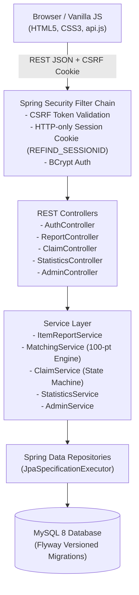

# PSG iTech — Smart Lost & Found Portal

PSG iTech Lost & Found is a full-stack college portal built with **Java 21**, **Spring Boot 3.4**, **MySQL 8**, and **Vanilla HTML5/CSS3/JavaScript**. It is branded for the PSG iTech community and accepts new student registrations only from `@psgitech.ac.in` accounts.

---

## 1. Key Features

- **Dual Reporting Mode:** Fast, responsive reporting forms with toggle between **LOST** and **FOUND** items, including title, category, description, color, brand, incident date, and campus zones.
- **Explainable 100-Point Matching Engine:** Signature deterministic algorithm comparing eligible lost items with found items across 5 weighted dimensions:
  1. *Category Match:* Up to 30 points.
  2. *Title & Description Keyword Overlap:* Up to 25 points.
  3. *Color & Brand Match:* Up to 20 points (Color 12, Brand 8).
  4. *Campus Location Proximity:* Up to 15 points (Exact 15, Same Zone 10, Adjacent Zone 5).
  5. *Incident Date Proximity:* Up to 10 points (Same day 10, Within 1 day 9, 3 days 7, 7 days 5, 14 days 3).
- **Automated Match Suggestions:** Reports display potential counter-matches with confidence badges, percentage scores, and an accordion breakdown of each criterion's contribution.
- **PSG iTech Accounts:** New registrations are enforced in the Java backend to use a `@psgitech.ac.in` email address. Reporter contact details remain visible only to authenticated users, avoiding public email and phone scraping.
- **Campus Office Handover:** A finder can record that a found item was submitted to an office, including the office name, collection contact, and instructions. The details are clearly displayed on the open report.
- **Daily Match Alerts:** A Java scheduled job checks every day for new score-qualified LOST/FOUND pairs and emails the lost-item reporter. A unique notification record prevents repeat mail for the same pair; failed deliveries remain eligible for a later retry.
- **Secure Two-Party Claim Workflow:**
  - Authenticated students file claims on found items providing private identifying proof (e.g. engravings, wallpaper, serial digits).
  - Private proof details are protected and visible only to the finder, claimant, and administrator.
  - The finder can review claims and **Approve** or **Reject** them. Approving automatically marks the item as **RESOLVED** and auto-rejects other pending claims.
  - Claimants cannot approve their own claims; duplicate pending claims are strictly blocked.
- **Real-Time Database Statistics:** Landing page and admin dashboard statistics are dynamically calculated from real MySQL records (no hardcoding).
- **Administrator Console:**
  - High-level metrics: registered users, total reports, open lost/found, resolved items, pending claims.
  - Moderate any report (Mark Resolved, Cancel, Reopen) with audit notes.
  - Review and moderate claims across the entire campus.
- **Modern Responsive UI:** Polished interface using native CSS3 (custom CSS variables, mobile drawer navigation, cards, toast notifications, confirmation modals) without frontend build tools or external JavaScript frameworks.

---

## 2. Technology Stack

| Layer | Technologies |
|---|---|
| **Frontend** | HTML5, CSS3, Vanilla JavaScript (ES6+), Fetch API |
| **Backend** | Java 21, Spring Boot 3.4.3 (Maven), Spring Mail scheduler |
| **Security** | Spring Security 6, Server-Side Sessions, BCrypt (cost factor 12), CSRF Cookie Protection |
| **Database** | MySQL 8.0, Spring Data JPA, Hibernate ORM (Schema validation mode) |
| **Migrations** | Flyway (Versioned SQL migrations `V1__init_schema.sql`, `V2__seed_categories.sql`) |
| **Monitoring** | Spring Boot Actuator (`/actuator/health`) |
| **Containers** | Docker (Multi-stage build, unprivileged user), Docker Compose |
| **Cloud Deployment** | Railway (Container-based deployment with managed MySQL service) |

---

## 3. Architecture & Request Flow



---

## 4. Database Schema

The normalized relational database schema is managed through Flyway versioned migrations:

- **`users`**: User accounts (`id`, `name`, `email` [UNIQUE], optional `contact_phone`, `password_hash`, `role` [ROLE_USER, ROLE_ADMIN], `created_at`, `updated_at`).
- **`categories`**: Pre-seeded campus item categories (`id`, `name` [UNIQUE], `description`, `icon`, `created_at`).
- **`item_reports`**: Lost and found postings plus optional campus-office handover details (`handed_to_office`, `office_name`, `office_contact`, `office_notes`, `handed_over_at`).
- **`match_notifications`**: Sent LOST/FOUND email-pair records, uniquely keyed per report pair to prevent notification spam.
- **`claims`**: Recovery claims (`id`, `report_id` [FK], `claimant_id` [FK], `claim_reason`, `proof_details`, `status` [PENDING, APPROVED, REJECTED, CANCELLED], `review_notes`, `reviewed_at`, `created_at`, `updated_at`).
- **`report_status_history`**: Audit trail of report status transitions (`id`, `report_id` [FK], `old_status`, `new_status`, `changed_by_user_id` [FK], `comments`, `created_at`).
- **`claim_status_history`**: Audit trail of claim decisions (`id`, `claim_id` [FK], `old_status`, `new_status`, `changed_by_user_id` [FK], `comments`, `created_at`).

---

## 5. REST API Contract

### Authentication & Session
- `POST /api/auth/register` — Register a new student account (`name`, `email`, `password`).
- `POST /api/auth/login` or `POST /login` — Establish an authenticated server-side session (`REFIND_SESSIONID`).
- `POST /api/auth/logout` or `POST /logout` — Invalidate session and clear authentication context.
- `GET /api/auth/csrf` — Retrieve active CSRF token.
- `GET /api/auth/me` — Check current session authentication status and user details.

### Reports & Matching
- `GET /api/reports` — Paginated search and filtering (`query`, `reportType`, `categoryId`, `locationZone`, `status`, `page`, `size`, `sortBy`, `direction`).
- `GET /api/reports/recent?limit=6` — Retrieve recent open notices for landing page.
- `GET /api/reports/{id}` — Fetch report details.
- `POST /api/reports` — Create a report (Requires authentication).
- `PUT /api/reports/{id}` — Edit an open report (Owner or Admin).
- `PATCH /api/reports/{id}/status` — Transition report status (`RESOLVED`, `CANCELLED`).
- `PATCH /api/reports/{id}/custody` — Finder or admin records/removes a handover to a campus office.
- `GET /api/reports/{id}/matches` — Run deterministic matching engine against counter-reports.
- `GET /api/users/me/reports` — Retrieve reports owned by the logged-in user.

### Claims Workflow
- `POST /api/reports/{id}/claims` — Submit an ownership claim on a FOUND item.
- `GET /api/reports/{id}/claims` — View claims for a report (Finder or Admin).
- `GET /api/users/me/claims` — List claims submitted by the logged-in user.
- `GET /api/users/me/received-claims` — List claims received on items found by the user.
- `PATCH /api/claims/{id}/status` — Review claim (`APPROVED`, `REJECTED`).

### Public Statistics
- `GET /api/statistics/public` — Returns live counts: `totalLostOpen`, `totalFoundOpen`, `totalResolved`, `totalPendingClaims`.

### Administration (Role: `ROLE_ADMIN`)
- `GET /api/admin/dashboard` — Complete campus system metrics.
- `GET /api/admin/reports` — Paginated list of all reports across campus.
- `PATCH /api/admin/reports/{id}/moderation` — Moderate report status with note.
- `GET /api/admin/claims` — List all claims filed across the system.

---

## 6. Local Setup and Development

### Prerequisites
- Java 21 JDK (or Microsoft OpenJDK 21)
- Git
- Docker and Docker Compose (optional for containerized run)

### Running Locally with Docker Compose (Recommended)

1. Clone the repository and navigate to the project directory:
   ```bash
   git clone <repository-url>
   cd refind
   ```

2. Copy the environment configuration:
   ```bash
   cp .env.example .env
   ```

3. Start the application and MySQL 8 database:
   ```bash
   docker compose up --build
   ```

4. Access the application in your browser:
   - Web Application: [http://localhost:8080](http://localhost:8080)
   - Health Check: [http://localhost:8080/actuator/health](http://localhost:8080/actuator/health)
   - Database on Host: `localhost:3307` (mapped to container port 3306 via `MYSQL_LOCAL_PORT` to prevent conflicts with local MySQL instances)
   - Initial Admin Account: `admin@psgitech.ac.in` / `Admin@12345`

5. Inspect container logs:
   ```bash
   docker compose logs -f app
   ```

6. Stop containers (preserving database volume):
   ```bash
   docker compose down
   ```
   > **Note:** To completely wipe database records and start fresh, run `docker compose down -v`.

---

### Running Locally without Docker (Maven Wrapper)

1. Ensure a local MySQL 8 server is running on port 3306 with database `refind_db`.
2. Configure credentials in your environment or update `src/main/resources/application.yml`:
   ```bash
   export MYSQLHOST=localhost
   export MYSQLPORT=3306
   export MYSQLDATABASE=refind_db
   export MYSQLUSER=root
   export MYSQLPASSWORD=yourpassword
   ```
3. Run the application via the Maven Wrapper:
   - On Linux/macOS:
     ```bash
     ./mvnw spring-boot:run
     ```
   - On Windows PowerShell:
     ```powershell
     .\mvnw.cmd spring-boot:run
     ```
4. Open [http://localhost:8080](http://localhost:8080).

### Enabling daily email alerts

Daily matching is deliberately disabled until an SMTP service is configured. Add these deployment variables when ready:

| Variable | Example | Purpose |
|---|---|---|
| `MATCH_NOTIFICATIONS_ENABLED` | `true` | Enables the daily Java scheduler. |
| `MATCH_NOTIFICATIONS_CRON` | `0 0 8 * * *` | Run time (08:00 server time, daily). |
| `MATCH_NOTIFICATIONS_FROM` | `lostfound@college.edu` | Sender address. |
| `SPRING_MAIL_HOST` / `SPRING_MAIL_PORT` | `smtp.office365.com` / `587` | SMTP host and port. |
| `SPRING_MAIL_USERNAME` / `SPRING_MAIL_PASSWORD` | SMTP credentials | SMTP login. |

For typical TLS SMTP servers also set `SPRING_MAIL_PROPERTIES_MAIL_SMTP_AUTH=true` and `SPRING_MAIL_PROPERTIES_MAIL_SMTP_STARTTLS_ENABLE=true`.

---

## 7. Running Automated Tests

Run the complete test suite (unit and integration tests) using the committed Maven wrapper:

- On Linux/macOS:
  ```bash
  ./mvnw clean verify
  ```
- On Windows:
  ```powershell
  .\mvnw.cmd clean verify
  ```

The test suite runs in-memory using an isolated test profile (`application-test.yml`), requiring no external MySQL server to run builds and verifications.

---

## 8. Deploying to Railway

The application is engineered from the ground up to deploy natively to [Railway](https://railway.app).

### Step-by-Step Deployment Instructions

1. **Push to GitHub:**
   Ensure your code is pushed to your GitHub repository:
   ```bash
   git remote add origin https://github.com/<your-username>/refind.git
   git branch -M main
   git push -u origin main
   ```

2. **Create a Railway Project:**
   - Log in to your Railway dashboard at [https://railway.app](https://railway.app).
   - Click **New Project** &rarr; **Deploy from GitHub repo**.
   - Select your `refind` repository.

3. **Add a MySQL Database Service:**
   - In the same Railway project canvas, click **+ New** &rarr; **Database** &rarr; **Add MySQL**.
   - Railway will provision a private MySQL 8 instance. Note the service name (usually `MySQL`).

4. **Configure Environment Variables on the Application Service:**
   In your application service's **Variables** tab, map the MySQL service connection using Railway reference variables:

   | Variable | Value (Railway Reference) | Description |
   |---|---|---|
   | `MYSQLHOST` | `${{MySQL.MYSQLHOST}}` | Private MySQL hostname |
   | `MYSQLPORT` | `${{MySQL.MYSQLPORT}}` | Private MySQL port (3306) |
   | `MYSQLDATABASE` | `${{MySQL.MYSQLDATABASE}}` | Database name (`railway`) |
   | `MYSQLUSER` | `${{MySQL.MYSQLUSER}}` | MySQL username (`root`) |
   | `MYSQLPASSWORD` | `${{MySQL.MYSQLPASSWORD}}` | Generated root password |
   | `ADMIN_BOOTSTRAP_ENABLED` | `true` | Idempotently creates admin on startup |
   | `ADMIN_EMAIL` | `admin@psgitech.ac.in` | Custom administrator email |
   | `ADMIN_PASSWORD` | `YourStrongAdminPassword!` | Custom administrator password |
   | `SESSION_COOKIE_SECURE` | `true` | Enforces HTTPS-only session cookies |

   > **Note on Service Names:** If your MySQL service was named something other than `MySQL` (e.g. `mysql-production`), adjust the reference prefix accordingly: `${{mysql-production.MYSQLHOST}}`.

5. **Configure Railway Service Settings:**
   - **Healthcheck Path:** Set to `/actuator/health` in **Settings &rarr; Deploy &rarr; Healthcheck Path**.
   - **Networking:** Click **Generate Domain** under **Networking &rarr; Public Networking** to assign a public URL (e.g. `refind-production.up.railway.app`).

6. **Automatic Flyway Migrations on Startup:**
   When the container boots, Flyway automatically connects through Railway's private network, runs `V1__init_schema.sql` and `V2__seed_categories.sql`, and starts serving static assets and API routes on the injected `$PORT`.

---

## 9. Administrator Account Setup

To securely access the admin dashboard (`/admin.html`):

1. Set `ADMIN_EMAIL` and `ADMIN_PASSWORD` in your Railway environment variables before the initial deployment.
2. The `AdminBootstrapService` runs automatically during startup. If an account with that email does not exist, it securely creates it with a BCrypt hash.
3. If the account already exists, it is **never overwritten**, ensuring safe restarts without resetting passwords.
4. Sign in at `/login.html` using the configured credentials to access the moderation dashboard.

---

## 10. Troubleshooting

- **Database Connection Refused on Startup:**
  Ensure that `MYSQLHOST` in Railway points to the private reference variable (`${{MySQL.MYSQLHOST}}`) and that both services belong to the same Railway environment.
- **CSRF Token Mismatch in API Calls:**
  All state-changing requests (`POST`, `PUT`, `PATCH`, `DELETE`) require the `X-XSRF-TOKEN` header. The included `js/api.js` client automatically fetches and manages this header.
- **Port Binding Issues:**
  Spring Boot is configured with `server.port=${PORT:8080}`, dynamically binding to Railway's assigned container port. Do not hardcode the port to `8080`.
